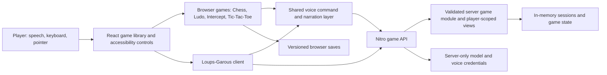

# Playora: a voice-first game library

Playora is a browser-based gaming companion designed around blind and low-vision play. The player can open a game without an account, hear the state that a visual interface would normally convey, issue spoken or typed commands, and ask for context when they need it. The current library contains **Chess, Loups-Garous, Ludo, The Intercept, and Tic-Tac-Toe**. Each game also has a visual interface, so collaborators can follow and test the same state.

This repository preserves two stages of the work:

| Directory | Purpose |
| --- | --- |
| [`GAME/`](GAME/) | The integrated five-game application. Run and deploy this directory. |
| [`prototype/`](prototype/) | The earlier chess-led prototype and implementation history. It is retained for comparison, not used by the integrated build. |

## The engineering idea

Accessibility is treated as a game-state problem, not as a screen-reading layer. A useful companion needs to know whose turn it is, which actions are legal, what just changed, and which information a player is allowed to know. The game rules therefore remain authoritative; narration and model output describe or request actions through validated interfaces. In Chess, for example, a spoken move reaches the same `chess.js` rules as a board interaction. In Loups-Garous, the guide receives a player-scoped view and cannot mutate the game by itself.

The five games also test different interaction shapes:

| Game | Authoritative logic | Player interaction |
| --- | --- | --- |
| Chess | `chess.js` in the browser; Stockfish worker with a local search fallback for computer moves | Move by square or speech; ask about pieces, legal moves, threats, history, and position |
| Loups-Garous | Server-side phase engine and NPC controllers | Investigate, discuss, vote, or request a private explanation without exposing hidden roles |
| Ludo | Browser-side two-player rules and computer policy | Roll, hear the die and legal tokens, choose a numbered token, and correct a move within its window |
| The Intercept | Pinned Ink story and InkJS runtime | Hear authored passages and choose numbered story options; resume a saved branch |
| Tic-Tac-Toe | Browser-side rules and difficulty-based computer play | Name a square, review the board, and play repeated rounds |

## Architecture



The UI is a React application built with Vite+; Nitro serves the API. `src/shell/AppShell.tsx` mounts one experience at a time and carries shared settings and game navigation. The browser games keep their own rules and local saves under `src/chess/` and `src/games/`. `src/voice/` routes library commands, owns the live connection, and keeps narration ordered. Server voice endpoints live under `server/voice/` and `server/api/`.

Loups-Garous has a separate server authority boundary. `server/game/module.ts` defines a typed module contract; `server/game/registry.ts` registers the current module. The action endpoint checks the session token and request ID, copies state before applying a command, validates the resulting action, and commits only a successful transition. Request receipts make retries idempotent within the current server process. This module API is **not yet** the runtime for all five games; the other four deliberately remain browser-side implementations.

### Voice and trust boundaries

Live voice uses a browser microphone and a WebRTC connection established through the server. The server reads `OPENAI_API_KEY` and brokers the voice session; the key is not shipped to the browser. Transcribed intent is interpreted as an action request, then passed to the relevant game controller. The app maintains one narration path so provider audio does not overlap the ordered game narration. Loups-Garous can also use browser speech recognition and speech synthesis where supported.

Model assistance is optional for the rules. Chess and the other browser games retain typed and visual controls when voice is unavailable. Loups-Garous uses local guide/NPC fallbacks when credentials or provider responses are unavailable. A successful browser test therefore does not by itself prove that a particular microphone, browser speech service, network, or model account can establish live voice.

## Run locally

From PowerShell, with a Node version accepted by [`GAME/package.json`](GAME/package.json) and Bun 1.4.4 installed:

```powershell
cd GAME
bun install --frozen-lockfile
bun run dev
```

Open the URL printed by Vite+ (normally `http://localhost:3000/`). The game library is at `http://localhost:3000/dashboard/`. The app opens without a login. To enable live provider voice, create `GAME/.env` locally with `OPENAI_API_KEY=your_key_here`, then restart the server. Keep the file out of Git; the root [`.gitignore`](.gitignore) excludes environment files. The default voice model is `gpt-live-1`; optional model and voice settings are documented in [`GAME/README.md`](GAME/README.md).

The voice path additionally needs a supported browser, microphone permission, model access, and network access. If the provider cannot connect, use typed commands or the visible controls to exercise the games. Do not place a key in client code or in a Vite public environment variable.

## Validate and build

Run these from `GAME/`:

```powershell
bun run check
bun run typecheck
bun run lint
bun run test
bun run build
bun run start
```

`bun run smoke http://127.0.0.1:3000` checks the landing and dashboard routes, health endpoint, Stockfish assets, and voice endpoint responses after a server starts. Unit and integration coverage lives beside the rule, voice, and server modules. The repository also includes [`GAME/FINAL-VALIDATION.md`](GAME/FINAL-VALIDATION.md), a record of the five-game validation and its limits; treat it as a historical run, not a claim that every future environment has been tested.

The build copies the pinned Stockfish JavaScript/WebAssembly worker into `public/stockfish/`. Generated outputs and installed dependencies are ignored. [`GAME/netlify.toml`](GAME/netlify.toml) contains the Netlify build configuration for the client and Nitro functions.

## Extending the library

There are two existing implementation routes, and a new game should choose one explicitly:

1. **Browser-managed game:** put pure rules and state transitions under `src/games/<game>/`, add a page and voice tools, persist a versioned save if needed, and register navigation in the shell and game catalog. Ludo, The Intercept, and Tic-Tac-Toe are concrete examples.
2. **Server-managed game:** implement the `GameModule` contract and register it in `server/game/registry.ts`; expose a player-safe view and validate every action on the server. Loups-Garous is the current example. Its default repository, locks, sessions, and retry receipts are in memory, so a durable multi-instance deployment would require shared storage for all four.

In both cases, define spoken state summaries and turn/event announcements alongside the rules. Voice commands should resolve to the same validated actions as typed or visual input. Do not rely on a generated description to decide whether a move is legal, whether a hidden fact may be revealed, or whether a game is won.

## Provenance and scope

Open-source source material and licenses are listed in [`GAME/THIRD_PARTY_NOTICES.md`](GAME/THIRD_PARTY_NOTICES.md). The Intercept uses an authored Ink story; Ludo's computer policy is a local implementation, with source research noted there. This is a playable prototype and an architecture for further games. The current server game store is process-local, and live voice quality depends on the browser and provider environment.

